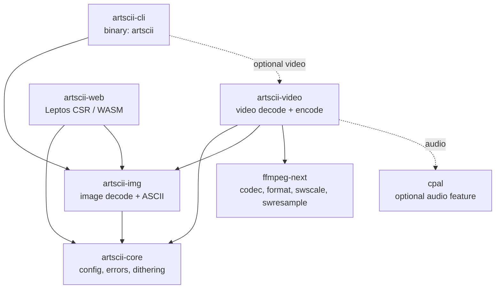
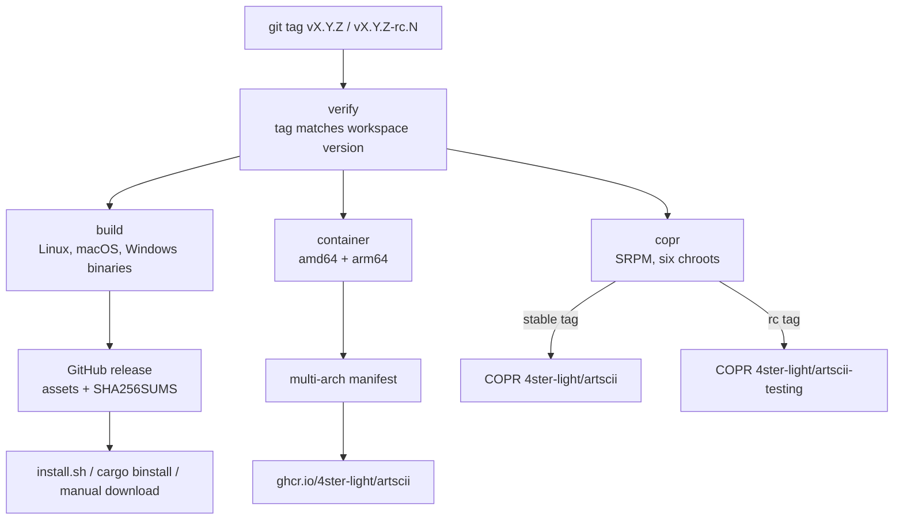

# Contributing to ✰ArtSCII✰

## Quick start

```bash
git clone git@github.com:4ster-light/artscii.git
cd artscii
nix develop          # pinned toolchain + ffmpeg, ALSA, clang, trunk, ...
nix flake check      # everything CI runs
```

## How the repository fits together



Everything shares one `Cargo.toml` workspace, one `Cargo.lock`, one pinned
`rust-toolchain.toml`, and one `[workspace.package]` version. The crates are
versioned and released together; do not split them across branches.

Distribution surface:



## Development workflow

### Branches

| Branch                | Purpose                                                    | Lifetime            |
| --------------------- | ---------------------------------------------------------- | ------------------- |
| `main`                | Always releasable. Everything merges here.                 | forever             |
| `feat/<slug>`         | New behaviour                                              | hours to days       |
| `fix/<slug>`          | Bug fixes                                                  | hours to days       |
| `packaging/<slug>`    | Spec, Containerfile, workflows, `install.sh`               | hours to days       |
| `chore/<slug>`        | Lockfile, toolchain, docs, tooling                         | hours to days       |
| `release/<major>.<minor>` | Stabilisation of one minor (RC fixes, hotfixes)        | RC.1 until X.Y.0 ships |

- Branch from `main`, keep the branch short, delete it after merging.
- Cut `release/<major>.<minor>` only when you actually need it: while RC fixes
  and next-minor work overlap, or when a shipped version needs a hotfix.
  Tagging RCs from `main` is fine before that.
- Merge `release/<major>.<minor>` back into `main` after the final tag.

### Commits

Use [Conventional Commits](https://www.conventionalcommits.org/) with the same
scopes the history already uses: `feat(video):`, `fix(cli):`, `ci(release):`,
`build(nix):`, `docs:`, `chore(release):`. One logical change per commit; keep
lockfile bumps and formatting sweeps in their own commits so `git bisect` stays
useful.

### Pull requests

`main` is protected:

- the `nix flake check` status check must pass
- history must stay linear, so only squash merges are enabled and the head
  branch is deleted automatically
- force pushes and deletions are blocked
- admins are exempt, so the maintainer can still push release chores directly,
  but anything non-trivial should go through a PR so the diff and the CI result
  are on record
- `strict` mode is off: you do not have to rebase onto `main` before merging

### What CI enforces

| Check | Where | Covers |
| --- | --- | --- |
| `nix flake check` | `.github/workflows/ci.yml` | formatting, clippy `-D warnings`, workspace tests, `cargo doc`, web clippy, Trunk build, the CLI build itself |
| `nix fmt -- --ci` | `.github/workflows/ci.yml` | Nix formatting (deliberately outside the flake) |
| packaging version guard | `.github/workflows/ci.yml` | `packaging/fedora/artscii.spec` `Version:` equals `[workspace.package]` |
| tag version guard | `.github/workflows/release.yml` | the pushed tag matches `[workspace.package]` |

Run the first two locally before pushing; they are the same commands CI runs.

## Releases

The version lives in exactly two places and CI keeps them in sync:

- `[workspace.package] version` in the root `Cargo.toml` (single source for all
  five crates and for the Nix builds)
- `Version:` in `packaging/fedora/artscii.spec`

To prepare a release:

1. Bump both versions, move the spec `%changelog` entry, commit as
   `chore(release): prepare X.Y.Z`.
2. Push `main`, then tag. The tag must match the workspace version:
   `vX.Y.Z` for a release, `vX.Y.Z-rc.N` for a candidate.

What each tag produces:

| Tag | GitHub release | GHCR | COPR |
| --- | --- | --- | --- |
| `vX.Y.Z` | published as latest | `:X.Y.Z` and `:latest` | `4ster-light/artscii` (stable) |
| `vX.Y.Z-rc.N` | flagged pre-release, not "latest" | `:X.Y.Z-rc.N` only | `4ster-light/artscii-testing` |

Release candidates build from a generated spec: COPR re-runs `rpmbuild -bs` on
the spec inside the uploaded SRPM, so the workflow rewrites the source tag to
`vX.Y.Z-rc.N` and the RPM release to `0.N` (which sorts below the stable `1`).
You do not have to do anything manually; just tag.

Hotfix after a release: branch `fix/<slug>` from the release tag, merge into
`release/X.Y`, tag `vX.Y.(Z+1)`, then merge `release/X.Y` back into `main`.

Tag hygiene: stable tags (`vX.Y.Z`) are immutable; never delete or move one.
Release-candidate tags can be removed together with their GitHub release when a
candidate is broken or superseded (`gh release delete vX.Y.Z-rc.N
--cleanup-tag`), but the `rc.N` number is never reused.

## Verify changes

```bash
nix flake check          # fmt + clippy + tests + docs + web checks
nix fmt -- --ci          # Nix file formatting (not part of flake check)
nix build .#artscii      # CLI at ./result/bin/artscii
nix build .#artscii-web  # static site at ./result
```

> [!IMPORTANT]
> `nix <COMMAND>` only sees files that are included in the flake source, so new
> workspace files must be tracked before it can see them.

---

> [!NOTE]
> `nix build`, `nix build .#default` and `nix build .#artscii` all build the CLI;
> only `.#artscii-web` builds the site. Each invocation replaces the `./result`
> symlink, so don't `cd` into it if you intend to rebuild (the shell keeps the
> old store path).

---

The following are useful for targeted checks:

```bash
nix develop -c cargo check --workspace
nix develop -c cargo test --workspace
nix develop -c cargo fmt --all --check
nix develop -c cargo clippy --all-targets --workspace -- -D warnings
```

Packaging changes can be checked without COPR:

```bash
make -C packaging/fedora srpm                       # stable SRPM
make -C packaging/fedora srpm PRERELEASE=-rc.1 RC=1 # pre-release SRPM
podman build -f packaging/container/Containerfile -t artscii .
```

## Flake structure

The flake is a thin [flake-parts](https://flake.parts/) bootstrap; the logic
lives in focused modules under `nix/`:

- `nix/utils/{packages,checks,devshell,formatter}.nix`: per-system outputs
- `nix/crane.nix`: shared Crane build context
- `nix/modules/{nixos,home-manager,overlay}.nix`: downstream integrations

## Workspace layout

```text
crates/artscii-core   # shared config, errors, and dithering strategy
crates/artscii-img    # image loading and ASCII conversion
crates/artscii-video  # video decoding and ASCII encoding
crates/artscii-cli    # binary CLI (installs `artscii`)
crates/artscii-web    # Leptos/WASM web app
packaging/fedora      # COPR spec + SRPM helpers
packaging/container   # Alpine image, published to GHCR on tags
nix/                  # flake modules and shared build context
```

## What to keep in mind

- Keep changes focused.
- Update docs when behaviour or structure changes.
- Prefer the Nix flake for local development and validation. The toolchain is
  pinned in `rust-toolchain.toml` and shared by `nix develop` and CI.
- The version is lockstep: bump `[workspace.package]` and the spec together.
- Mention any extra commands needed to verify your change.

## Need help?

Open an issue before a larger refactor if you want to discuss the shape first.
