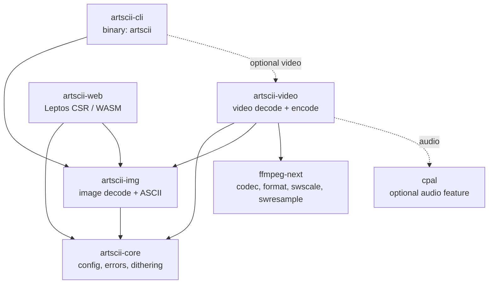

# ✰ArtSCII✰

[](https://github.com/4ster-light/artscii/releases/latest)
[](https://artscii.pages.dev)
[](https://github.com/4ster-light/artscii/releases/latest)
[](flake.nix)
[](https://copr.fedorainfracloud.org/coprs/4ster-light/artscii)

[](https://github.com/4ster-light/artscii/actions/workflows/ci.yml)
[](https://copr.fedorainfracloud.org/coprs/4ster-light/artscii/builds/)
[](https://www.rust-lang.org)
[](crates/artscii-web)

[](https://github.com/sponsors/4ster-light)
[](LICENSE)

A workspace with the shared foundation crate, a reusable image-conversion crate and
a video conversion crate, a CLI binary, and a web app built on WASM.

## Table of Contents

- [Features](#features)
- [Workspace](#workspace)
- [Using the crate](#using-the-crate)
- [Installation](#installation)
  - [Which method should I use?](#which-method-should-i-use)
  - [Fedora (COPR)](#fedora-copr)
  - [Nix](#nix)
  - [Container](#container)
  - [cargo-binstall](#cargo-binstall)
  - [Install script](#install-script)
  - [Prebuilt binaries](#prebuilt-binaries)
  - [Cargo](#cargo)
- [Usage](#usage)
  - [Options](#options)
  - [Example Commands](#example-commands)
  - [Dithering Algorithms](#dithering-algorithms)
- [Building from Source](#building-from-source)
  - [Dependencies](#dependencies)
- [License](#license)

## Features

- **Multiple dithering algorithms**: Floyd-Steinberg, Atkinson, and Riemersma
- **Color support**: ANSI colors for terminal and text output, RGB for HTML
  output
- **Multiple output formats**: Terminal, plain text, colorized text, styled
  HTML, GIF, and MP4
- **Video to ASCII animation**: Convert video to animated ASCII in terminal,
  GIF, or MP4
- **Image adjustments**: Resolution, contrast, and brightness controls
- **Wide format support**: PNG, JPG, GIF, BMP, WebP, and more
- **Browser-based**: Convert images to ASCII art entirely client-side via
  WebAssembly

## Workspace

The project is organized as a Cargo workspace with the following crates:

| Crate                                   | Description                                     | Type          |
| --------------------------------------- | ----------------------------------------------- | ------------- |
| [`artscii-core`](crates/artscii-core)   | Shared config, errors, and dithering strategies | Library       |
| [`artscii-img`](crates/artscii-img)     | Image loading and ASCII conversion              | Library       |
| [`artscii-video`](crates/artscii-video) | Video decoding and ASCII encoding               | Library       |
| [`artscii-web`](crates/artscii-web)     | Browser-based WASM converter                    | Binary (WASM) |
| [`artscii-cli`](crates/artscii-cli)     | Command-line interface                          | Binary        |



The three library crates (`core`, `img`, `video`) are designed to be usable from
other Rust projects. See each crate's README for details.

## Using the crate

Use `artscii-img` from another Rust project as a local path dependency:

```bash
cargo add --git https://github.com/4ster-light/artscii artscii-img
# If you want to lock it to a branch, tag or commit:
cargo add --git https://github.com/4ster-light/artscii --branch main artscii-img
cargo add --git https://github.com/4ster-light/artscii --tag v1.1.0 artscii-img
cargo add --git https://github.com/4ster-light/artscii --rev <commit-sha> artscii-img
```

Or, in `Cargo.toml`:

```toml
[dependencies]
artscii-img = { git = "https://github.com/4ster-light/artscii", branch = "main" }
```

Same applies for `artscii-core` if you want to use the shared types and config,
or `artscii-video`.

The CLI crate builds the `artscii` binary.

## Installation

### Which method should I use?

| Your situation | Recommended | What you get |
| --- | --- | --- |
| Fedora 44, 45 or rawhide | [Fedora (COPR)](#fedora-copr) | Native package, updated by `dnf`, uses the system ffmpeg, video and audio |
| NixOS or Nix | [Nix](#nix) | Flake package, NixOS/home-manager modules, overlay, video and audio |
| Immutable distro, CI, or you want nothing installed on the host | [Container](#container) | Full features inside an Alpine image (~58 MB compressed) |
| macOS or Windows | [cargo-binstall](#cargo-binstall) | Prebuilt binary with video support |
| Any Linux without a toolchain, including Alpine, Debian, Ubuntu and Arch | [Install script](#install-script) | Static binary with ffmpeg linked in, no runtime dependencies |
| You already have Rust and ffmpeg | [Cargo](#cargo) | Built against your own ffmpeg, video and audio |

All methods provide video support (decoding, GIF and MP4 export). Terminal audio
playback is missing only from the static Linux binary that `install.sh` and
`cargo binstall` install; MP4 audio passthrough works there too.

### Fedora (COPR)

Fedora 44, 45 and rawhide, x86_64 and aarch64:

```bash
sudo dnf copr enable 4ster-light/artscii
sudo dnf install artscii
```

The package links the distribution's ffmpeg and ALSA libraries, so codec
support follows the ffmpeg package you have installed, and `dnf remove artscii`
cleans up after it. Source is in `packaging/fedora/` if you prefer to build the
RPM yourself.

### Nix

Run without installing:

```bash
nix run github:4ster-light/artscii -- image.jpg
```

Install into your profile:

```bash
nix profile add github:4ster-light/artscii
```

The flake also exposes `overlays.default`, `nixosModules.default`, and
`homeManagerModules.default` for declarative installs.

**NixOS:**

```nix
{
  inputs.artscii.url = "github:4ster-light/artscii";

  outputs =
    { nixpkgs, artscii, ... }:
    {
      nixosConfigurations.myhost = nixpkgs.lib.nixosSystem {
        modules = [
          artscii.nixosModules.default
          { programs.artscii.enable = true; }
        ];
      };
    };
}
```

**home-manager:**

```nix
{
  inputs.artscii.url = "github:4ster-light/artscii";

  outputs =
    { home-manager, artscii, ... }:
    {
      homeConfigurations."user@host" = home-manager.lib.homeManagerConfiguration {
        modules = [
          artscii.homeManagerModules.default
          { programs.artscii.enable = true; }
        ];
      };
    };
}
```

Without the modules you can add the package (or the overlay) directly:

```nix
home.packages = [ inputs.artscii.packages.${pkgs.system}.artscii ];

# ...or use the overlay:
# nixpkgs.overlays = [ inputs.artscii.overlays.default ];
# home.packages = [ pkgs.artscii ];
```

### Container

A full-featured image (video, GIF/MP4 export, audio) is published to the GitHub
Container Registry on every release. It is tagged `:latest` for stable
releases, `:X.Y.Z` for a specific stable release and `:X.Y.Z-rc.N` for release
candidates; until the first stable image exists, use `:2.1.0-rc.1`.

```bash
podman run --rm -v "$PWD:/work:z" -w /work \
  ghcr.io/4ster-light/artscii:latest image.jpg -o out.html
```

Rebuild it yourself with `podman build -f packaging/container/Containerfile -t artscii .`.

Notes:

- The `:z` on the bind mount is required on SELinux hosts (Fedora/RHEL);
  without it the container cannot read the mounted files.
- Interactive output and video playback need a TTY (`podman run -it`), and audio
  playback additionally needs `--device /dev/snd` (or a PulseAudio/PipeWire
  socket mount).
- Output files are written into the mounted directory and end up owned by you
  (rootless podman maps the container's root to your user).
- The image is Alpine-based (~58 MB compressed) and bundles ffmpeg, so nothing
  has to be installed on the host.

### cargo-binstall

[cargo-binstall](https://github.com/cargo-bins/cargo-binstall) installs a
prebuilt binary from GitHub Releases. The crate is not published to crates.io,
so point binstall at the repository:

```bash
# Install cargo-binstall once (see its README for a prebuilt installer)
cargo install cargo-binstall

# Install ArtSCII
cargo binstall --git https://github.com/4ster-light/artscii artscii-cli
```

> [!NOTE]
> Every platform downloads a prebuilt binary. The Linux assets are static musl
> builds with ffmpeg linked in, so no toolchain or system libraries are needed;
> they include everything except terminal audio playback.

### Install script

Linux and macOS, no Rust toolchain required:

```bash
curl -fsSL https://raw.githubusercontent.com/4ster-light/artscii/main/install.sh | sh
```

Windows (PowerShell):

```powershell
irm https://raw.githubusercontent.com/4ster-light/artscii/main/install.ps1 | iex
```

On Linux the script installs the static musl binary: ffmpeg is linked in, so it
runs on any distribution (glibc, musl, Alpine, NixOS, immutable images) with
nothing installed and no glibc requirement. Video, GIF and MP4 export work out
of the box; terminal audio playback needs a native package, the container or a
source build. On macOS it installs the standalone binary.

Pinned older releases still work: if the static asset is missing, the script
falls back to the tarball that shipped before 2.1.0.

The script installs into `~/.local/bin`
(`%LOCALAPPDATA%\Programs\artscii` on Windows). Override the destination with
`ARTSCII_INSTALL_DIR` (or `$env:ARTSCII_INSTALL_DIR`), and select a specific
release with `ARTSCII_VERSION` (for example `v2.1.0`).

### Prebuilt binaries

Download the asset for your platform from the
[latest release](https://github.com/4ster-light/artscii/releases/latest):

| Platform       | Asset                        | Notes                                        |
| -------------- | ---------------------------- | -------------------------------------------- |
| Linux x86_64   | `artscii-linux-x86_64`       | Static musl, runs on any Linux, no dependencies |
| Linux ARM64    | `artscii-linux-aarch64`      | Static musl, runs on any Linux, no dependencies |
| macOS x86_64   | `artscii-macos-x86_64`       |                                              |
| macOS ARM64    | `artscii-macos-aarch64`      |                                              |
| Windows x86_64 | `artscii-windows-x86_64.exe` |                                              |

Each asset ships with a matching `.sha256` checksum, plus an aggregated
`SHA256SUMS` file. After downloading:

```bash
# Linux (static, no runtime dependencies)
chmod +x artscii-linux-x86_64
./artscii-linux-x86_64 --help

# macOS / Windows
chmod +x artscii-macos-x86_64
./artscii-macos-x86_64
```

> [!NOTE]
> The Linux binaries are static musl builds: image conversion, video decoding,
> GIF export and MP4 export (via MPEG-4 Part 2 or H.264 when the build has an
> encoder) work with nothing installed. Terminal audio playback is only in the
> native packages, the container and source builds, because it needs ALSA.

### Cargo

Install the CLI from source (the crate builds the `artscii` binary):

```bash
cargo install --locked --git https://github.com/4ster-light/artscii artscii-cli
```

The default build includes video decoding, GIF/MP4 export and terminal audio
playback. To drop audio playback (and the ALSA dependency) but keep video:

```bash
cargo install --locked --no-default-features --features video \
  --git https://github.com/4ster-light/artscii artscii-cli
```

For image conversion only:

```bash
cargo install --locked --no-default-features \
  --git https://github.com/4ster-light/artscii artscii-cli
```

Arch Linux has no AUR package yet, so `cargo` (or the container) is the way to
install it there today.

## Usage

### Options

| Flag | Long               | Description                         | Default  |
| ---- | ------------------ | ----------------------------------- | -------- |
| `-o` | `--output`         | Output file path                    | stdout   |
| `-f` | `--format`         | Output format (terminal/text/html)  | auto     |
| `-r` | `--resolution`     | Scale factor (0.01-1.0)             | 0.3      |
|      | `--contrast`       | Contrast (0.1-3.0)                  | 1.0      |
| `-b` | `--brightness`     | Brightness (0.1-3.0)                | 1.0      |
| `-i` | `--invert`         | Invert character mapping            | false    |
| `-c` | `--color`          | Enable colored output               | false    |
| `-d` | `--dithering`      | Dithering algorithm                 | none     |
| `-q` | `--quiet`          | Suppress info messages              | false    |
|      | `--video`          | Enable video mode                   | false    |
|      | `--video-format`   | Video output (terminal/gif/mp4)     | terminal |
|      | `--preserve-audio` | Keep original audio in output files | false    |

### Example Commands

```bash
# Basic usage - display in terminal
artscii image.jpg

# With colors
artscii image.jpg -c

# Save as plain text
artscii image.jpg -o output.txt

# Save ANSI-colored text
artscii image.jpg -c -o output.txt

# Save as styled HTML with colors
artscii image.jpg -o output.html -c

# Higher resolution with Atkinson dithering
artscii image.jpg -r 0.5 -d atkinson

# Adjust contrast and brightness
artscii image.jpg --contrast 1.5 -b 0.8

# Invert characters (for light backgrounds)
artscii image.jpg -i

# Quiet mode (only output the art)
artscii image.jpg -q

# Play video as ASCII animation in terminal
artscii video.mp4 --video

# Play video in terminal with colors
artscii video.mp4 --video -c

# Export video as animated GIF (colored, higher resolution)
artscii video.mp4 --video --video-format gif -c -r 0.5 -o output.gif

# Export video as MP4 (colored, with original audio)
artscii video.mp4 --video --video-format mp4 -c --preserve-audio -o output.mp4
```

> And what I think is the best result for the example image in this repo:
>
> ```bash
> artscii image.jpg -c -b 1.5 -r 0.26 -d atkinson -o img.html
> ```

### Dithering Algorithms

- **none**: No dithering (default)
- **floyd-steinberg**: Classic error-diffusion dithering
- **atkinson**: Sharper dithering (preserves more contrast)
- **riemersma**: Space-filling curve dithering

## Building from Source

Building from source requires system libraries for video and audio support.

### Dependencies

| Platform   | Build dependencies                                                                                                                                                       |
| ---------- | ------------------------------------------------------------------------------------------------------------------------------------------------------------------------ |
| Nix        | `nix develop` (all deps included)                                                                                                                                        |
| Fedora     | `gcc pkgconf-pkg-config clang-devel ffmpeg-free-devel alsa-lib-devel`                                                                                                    |
| Debian     | `build-essential pkg-config libclang-dev libavcodec-dev libavformat-dev libavutil-dev libavfilter-dev libavdevice-dev libswscale-dev libswresample-dev libasound2-dev`   |
| Arch       | `base-devel pkgconf clang ffmpeg alsa-lib`                                                                                                                               |
| macOS      | `brew install ffmpeg`                                                                                                                                                    |

ALSA is only needed for the default `audio` feature (terminal playback); MP4
audio passthrough uses ffmpeg directly. Feature combinations:

```bash
cargo build --release                                  # images + video + audio
cargo build --release --no-default-features --features video   # no audio, no ALSA
cargo build --release --no-default-features            # image conversion only
```

```bash
# CLI binary at ./result/bin/artscii
nix build .#artscii

# Static WASM site at ./result
nix build .#artscii-web

# Dev shell with the pinned Rust toolchain, trunk, ...
nix develop

# fmt + clippy + tests + docs + web checks
nix flake check

# Nix file formatting
nix fmt -- --ci
```

The Rust toolchain is pinned in `rust-toolchain.toml` and shared by the dev
shell, the Nix builds, and CI. CI (`.github/workflows/ci.yml`) runs the same
`nix flake check` plus `nix fmt -- --ci` on every pull request, so the checks
above are exactly what has to pass. If you are already inside `nix develop`, the
usual `cargo` commands work as-is.

Without Nix, install the dependencies listed above, then:

```bash
cargo build --release
```

## License

MIT
